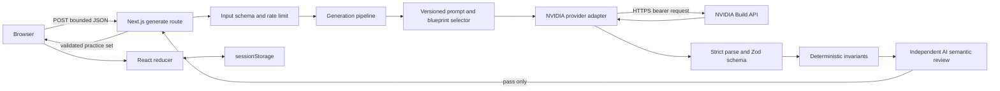

# Topicore MVP Technical Architecture

Status: Accepted design for P3 implementation

Research date: 2026-10-27

Scope: SQL and Python question generation and self-contained practice on the web

This document translates the permanent rules in `AGENTS.md` and `docs/PROJECT_STANDARDS.md` into an
implementable MVP design. It does not describe functionality that already exists; the repository
remains documentation-only at the end of P2.

## 1. Executive decision

Build Topicore as one full-stack Next.js application using TypeScript, React, Tailwind CSS, and Zod.
A single server route validates a bounded request, calls the NVIDIA Build API through a narrow
native-`fetch` adapter, validates and independently reviews the model output, and returns a complete
practice set. The browser owns the active practice session and stores it in `sessionStorage` for
refresh recovery.

Do not add a database, authentication, separate API service, queue, vector store, global
client-state library, component kit, AI SDK, or generated-code execution to the launch architecture.

The launch question modes are:

- `multiple_choice`: four choices, one answer, objectively scored in the browser;
- `written`: a free-text response followed by a reference answer and key points; the learner
  self-assesses rather than receiving a false claim of automatic semantic correctness; and
- `mixed`: a request preference that produces both stored question types.

This is a practice product, not a secure examination system. Answer keys are sent to the browser and
hidden by interface state until review. Preventing a learner from inspecting their own browser data
would require server persistence or encrypted tokens and is not justified for the MVP.

## 2. Assumptions, constraints, and non-goals

### Assumptions

- Users provide one supported subject, one to five short topic descriptions, a difficulty, a
  question count, and a mode.
- Topic text can be arbitrary user input and is untrusted, but it contains no data Topicore needs to
  retain after the browser session.
- NVIDIA model availability, quotas, pricing, and structured-output support can vary by account and
  model. The selected model must pass a live compatibility gate in P3.
- An NVIDIA API credential will be supplied to the deployed server as `NVIDIA_API_KEY`; it is never
  required in the browser.
- Launch traffic is low enough for one deployable application. Public release still requires an
  enforceable rate limit and concurrency cap.

### Launch non-goals

- Accounts, cloud history, synchronization, sharing, leaderboards, payments, and analytics.
- Running user or model-generated SQL or Python.
- A code editor, hidden test runner, notebook, judge service, or execution sandbox.
- RAG, embeddings, fine-tuning, a vector database, or a question database.
- Streaming partially validated model content into the UI.
- Multi-provider routing or automatic provider failover.
- Native mobile applications and offline generation.

## 3. Research findings

### 3.1 Comparable product patterns

The useful pattern is a focused practice workspace, not a clone of any one product.

| Product family                 | Useful pattern                                                                                             | Topicore adoption                                                                 | Deliberate omission                                          |
| ------------------------------ | ---------------------------------------------------------------------------------------------------------- | --------------------------------------------------------------------------------- | ------------------------------------------------------------ |
| LeetCode-style coding practice | Clear problem statement, persistent progress, distinct attempt and review actions, desktop split workspace | Two-pane practice layout on large screens; explicit submit/review; clear progress | Code runner, contests, submissions backend, dense navigation |
| HackerRank-style challenges    | Requirements and response area remain visible together; feedback is action-driven                          | Keep prompt and answer context together; never grade before an intentional action | Hidden execution tests at launch                             |
| Guided learning products       | Small steps, hints, immediate recovery, completion summary                                                 | Optional hint, one-question focus, plain-language feedback, restart flow          | Courses, streaks, gamification, mastery profiles             |

The interaction lesson is to preserve focus and context. Topicore should not imitate brand assets,
scoring systems, or editor chrome when it has no code runner.

### 3.2 Effective LLM generation workflow

Reliability comes from narrowing the model's task and distrusting its response:

1. Validate and normalize user input before prompt construction.
2. Select a versioned subject/mode template and deterministic blueprint mix.
3. Put policy and output rules in the system message; serialize user topics as delimited data rather
   than interpolating them as instructions.
4. Request only JSON with a strict, discriminated schema and bounded lengths.
5. Parse the entire response as JSON. Do not salvage prose or code fences.
6. Run Zod structural validation and deterministic invariants.
7. Send the valid draft through a separate semantic-review prompt at temperature zero. The reviewer
   returns pass/fail per question and cannot call tools.
8. Publish only when every question passes. Fail closed after the bounded attempt budget and
   preserve the form so the user can retry intentionally.

A second model call adds latency and cost, but it is the smallest credible semantic check for
arbitrary topics without a curated answer bank or execution sandbox. It is still correlated AI
review, not proof. Deterministic template families should expand over time so fewer claims depend
only on model judgment.

### 3.3 NVIDIA API findings

Verified from current official NVIDIA source examples:

- NVIDIA examples use the OpenAI-compatible base URL `https://integrate.api.nvidia.com/v1` and a
  server-side `NVIDIA_API_KEY`.
- Current examples call `/chat/completions` and demonstrate Nemotron model IDs.
- An NVIDIA example demonstrates constrained JSON through a top-level NVIDIA extension equivalent to
  `nvext.guided_json` (passed as an SDK `extra_body`). This is evidence of a supported NIM
  mechanism, not proof that every hosted model or account accepts it.
- The live-tested replacement is `nvidia/nemotron-3.5-lightning-30b-a3b` against the hosted base URL
  and link `nvidia/nemotron-nano-9b-v2` to a Nemotron NIM.
- The accessible official sources did not establish a stable numeric hosted quota. Topicore must
  therefore treat HTTP 429 and `Retry-After` as authoritative and must not hardcode a claimed NVIDIA
  account limit.

The official documentation host returned HTTP 403 from the research environment, so model-specific
hosted compatibility, current account quota, context limit, price, and guided-JSON behavior remain
P3 live-test gates. The architecture never assumes those capabilities silently.

### 3.4 Technology alternatives

| Option                                         | Complexity        | Reliability and maintenance                                                      | Latency/cost                                                 | Decision       |
| ---------------------------------------------- | ----------------- | -------------------------------------------------------------------------------- | ------------------------------------------------------------ | -------------- |
| Next.js App Router, TypeScript, one deployment | Low               | One language, one repository, server-only route boundary, mature React ecosystem | One browser-to-app hop plus NVIDIA; low operational overhead | **Choose**     |
| Vite React plus Hono/Express API               | Medium            | Clear separation but two builds/process concerns, CORS, duplicated configuration | Similar runtime; more deployment surface                     | Reject for MVP |
| React frontend plus Python/FastAPI             | Medium-high       | Good AI ecosystem, but two languages and contracts for a solo developer          | Extra service/deployment or combined-container complexity    | Reject for MVP |
| Static-only frontend calling NVIDIA            | Superficially low | Exposes the API key and removes enforceable validation/abuse controls            | Cheap but unsafe                                             | Reject         |
| Microservices/event pipeline                   | Very high         | More failure modes and operations with no present need                           | Higher latency and cost                                      | Reject         |

## 4. Selected stack

P3 should install mutually compatible stable releases and commit the lockfile. The versions below
are the stable families researched on 2026-10-27, not permission to use preview or canary builds.

| Concern                | Choice                                                                   | Reason                                                                                 |
| ---------------------- | ------------------------------------------------------------------------ | -------------------------------------------------------------------------------------- |
| Runtime                | Node.js 24 LTS                                                           | Supported through 2028-04-30; conservative choice while Node 26 reaches LTS            |
| Package manager        | npm with committed `package-lock.json`                                   | Already bundled, smallest toolchain decision                                           |
| Web framework          | Next.js 16 App Router on Node runtime                                    | Full-stack boundary in one application; no separate API server                         |
| UI                     | React 19 and TypeScript                                                  | Strong typing and standard Next.js composition                                         |
| Styling                | Tailwind CSS 4 plus CSS custom-property design tokens                    | Fast consistent UI without a component framework                                       |
| Runtime schemas        | Zod 4                                                                    | One source for parsing and inferred TypeScript types; JSON Schema conversion available |
| NVIDIA transport       | Native server-side `fetch`                                               | One endpoint does not justify an OpenAI or NVIDIA SDK dependency                       |
| Local state            | React `useReducer`                                                       | Session state is finite and local; Redux/Zustand are unnecessary                       |
| Unit/integration tests | Vitest 5, Testing Library, MSW only if native fetch stubs become brittle | Fast TypeScript tests; add MSW only on demonstrated need                               |
| Browser tests          | Playwright 1.x                                                           | Real browser isolation, auto-waiting, and accessible user workflows                    |
| Static checks          | TypeScript strict mode, ESLint, Prettier                                 | Deterministic quality gates                                                            |

The implemented lockfile uses Next.js 16.4.3, React 19.3.1, TypeScript 6.0.2, Tailwind CSS 4.3.3,
Zod 4.6.7, Vitest 5.0.5, Playwright 1.64.1, and ESLint 9.39.5. These versions pass the production
build together; updates must continue to be verified as a compatible set.

No component library is needed for the launch screens. Use semantic HTML and a small set of local
primitives. Avoid dialogs in the initial workflow when an inline notice or page transition is
clearer and more accessible.

## 5. System architecture



Trust boundaries:

1. Browser to route: all request data is untrusted.
2. Application to NVIDIA: secrets cross only the server-side outbound boundary.
3. NVIDIA to application: every byte is untrusted until parsed, bounded, validated, and reviewed.
4. Application to browser: text is rendered as text/React nodes, never AI-generated HTML.
5. Browser storage: convenient recovery only, not trusted authority or private storage.

## 6. Ownership boundaries

| Module            | Owns                                                                               | Must not own                                    |
| ----------------- | ---------------------------------------------------------------------------------- | ----------------------------------------------- |
| `domain/practice` | Enumerations, request and question schemas, limits, pure scoring rules             | HTTP, React, provider details                   |
| `generation`      | Blueprint selection, prompt versions, orchestration, validation sequence           | Route response formatting, visual state         |
| `ai/nvidia`       | Authentication header, request/response transport, timeout, provider error mapping | Domain validation or UI messages                |
| `verification`    | Deterministic invariants and semantic-review contract                              | Network transport details                       |
| `app/api`         | HTTP parsing, origin/content checks, rate limit, request ID, response mapping      | Prompt strings and grading rules                |
| `components`      | Semantic controls and practice presentation                                        | API keys, prompt construction, answer authority |
| `state`           | Client reducer, session-storage serialization and migration                        | Server secrets or provider calls                |

The provider boundary is intentionally one small interface, not a general plugin system:

```ts
interface QuestionModel {
  generate(request: ModelRequest, signal: AbortSignal): Promise<ModelTextResponse>;
}
```

## 7. Planned directory structure

```text
TopicoreC/
├── AGENTS.md
├── README.md
├── docs/
│   ├── ARCHITECTURE.md
│   ├── PROJECT_STANDARDS.md
│   ├── ROADMAP.md
│   └── decisions/
│       └── 0001-mvp-architecture.md
├── public/
├── src/
│   ├── app/
│   │   ├── api/practice/generate/route.ts
│   │   ├── practice/page.tsx
│   │   ├── globals.css
│   │   ├── layout.tsx
│   │   └── page.tsx
│   ├── components/
│   │   ├── ui/
│   │   │   ├── alert.tsx
│   │   │   ├── button.tsx
│   │   │   ├── field.tsx
│   │   │   └── progress.tsx
│   │   ├── practice-config-form.tsx
│   │   ├── practice-question.tsx
│   │   ├── practice-review.tsx
│   │   └── practice-workspace.tsx
│   ├── domain/practice/
│   │   ├── constants.ts
│   │   ├── schemas.ts
│   │   ├── scoring.ts
│   │   └── types.ts
│   ├── generation/
│   │   ├── blueprints.ts
│   │   ├── pipeline.ts
│   │   ├── prompts/
│   │   │   ├── generator-v1.ts
│   │   │   └── reviewer-v1.ts
│   │   └── validate-draft.ts
│   ├── ai/nvidia/
│   │   ├── client.ts
│   │   ├── errors.ts
│   │   └── types.ts
│   ├── verification/
│   │   ├── deterministic.ts
│   │   └── semantic-review.ts
│   ├── server/
│   │   ├── config.ts
│   │   ├── problem-response.ts
│   │   ├── rate-limit.ts
│   │   └── request-id.ts
│   └── state/
│       ├── practice-reducer.ts
│       └── session-storage.ts
├── tests/
│   ├── fixtures/ai/
│   ├── integration/
│   ├── unit/
│   └── e2e/
├── .env.example
├── next.config.ts
├── package.json
├── playwright.config.ts
├── tsconfig.json
└── vitest.config.ts
```

This is a target map, not a requirement to create empty folders. Add each module when its milestone
needs it. Do not create generic `utils`, `services`, or `helpers` directories.

## 8. User workflows

### 8.1 Generate and begin

1. The home page shows one concise configuration form.
2. Subject selection updates topic suggestions but never erases custom text without warning.
3. Client validation gives immediate, field-linked feedback; server validation is still
   authoritative.
4. Generate disables duplicate submission, announces progress, and offers cancel.
5. On success, the set is written to `sessionStorage` and navigation moves to `/practice` at
   question one.
6. On failure, the form and values remain. The error explains whether retrying is useful and
   includes no provider internals.

### 8.2 Attempt

1. The workspace shows subject, progress, current topic/difficulty, prompt, and response area.
2. A learner selects one MCQ option or enters a written response.
3. Hint reveal is optional and recorded only in local session state.
4. Previous and Next retain answers. Unanswered questions are visibly distinguishable in the
   progress navigator.
5. Submit practice requires an intentional action and summarizes unanswered items; it does not
   silently discard them.

### 8.3 Review and finish

1. Submission locks the attempt and reveals answers, explanations, and hints.
2. MCQs are scored deterministically from option IDs.
3. Written answers display the learner response, reference answer, and key points; the learner
   chooses `Got it` or `Needs review`. Topicore does not claim an AI semantic score.
4. The summary separates objective MCQ score from written self-assessment and lists questions to
   revisit.
5. `Practice again` returns to the populated configuration form. `New session` clears it. Both
   controls perform their named behavior.

### 8.4 Recovery

- Refresh restores a valid active session from versioned `sessionStorage`.
- Invalid, oversized, or obsolete storage is discarded safely and `/practice` returns to the
  generator with a plain-language notice.
- Closing the tab may end the session; cross-device history is explicitly absent.

## 9. Domain and data model

These are architectural contracts. P3 will encode them as strict Zod schemas and infer the
TypeScript types.

```ts
type Subject = "sql" | "python";
type Difficulty = "beginner" | "intermediate" | "advanced";
type RequestedMode = "multiple_choice" | "written" | "mixed";
type QuestionType = "multiple_choice" | "written";

interface GeneratePracticeSetRequest {
  subject: Subject;
  topics: string[]; // 1..5, each normalized and bounded
  difficulty: Difficulty;
  questionCount: number; // integer 1..10
  mode: RequestedMode;
}

interface QuestionBase {
  id: string; // server-generated; never trusted from the model
  type: QuestionType;
  topic: string;
  difficulty: Difficulty;
  prompt: string;
  code?: { language: Subject; source: string };
  hint: string;
  explanation: string;
}

interface MultipleChoiceQuestion extends QuestionBase {
  type: "multiple_choice";
  options: [
    { id: "a"; text: string },
    { id: "b"; text: string },
    { id: "c"; text: string },
    { id: "d"; text: string },
  ];
  answer: { optionId: "a" | "b" | "c" | "d" };
}

interface WrittenQuestion extends QuestionBase {
  type: "written";
  referenceAnswer: string;
  keyPoints: string[]; // 1..5 concise criteria
}

type PracticeQuestion = MultipleChoiceQuestion | WrittenQuestion;

interface PracticeSet {
  schemaVersion: "1.0";
  sessionId: string;
  createdAt: string;
  config: GeneratePracticeSetRequest;
  questions: PracticeQuestion[];
}
```

The model draft excludes `sessionId`, `createdAt`, and public question IDs. The server creates them
after acceptance, preventing model-controlled identifiers.

Client-only state:

```ts
type WrittenAssessment = "got_it" | "needs_review";

interface PracticeSessionState {
  version: 1;
  phase: "active" | "review" | "complete";
  set: PracticeSet;
  currentIndex: number;
  answers: Record<string, { optionId?: string; text?: string }>;
  revealedHintIds: string[];
  writtenAssessments: Record<string, WrittenAssessment>;
}
```

Limits start conservative and live in one domain constants module: at most five topics, 80
normalized characters per topic, ten questions, 12,000 characters across accepted model fields, 8
KiB request bodies, and 256 KiB provider response bodies. P3 can tighten these with fixture
evidence; increasing them requires cost and abuse review.

## 10. API contract

### `POST /api/practice/generate`

Headers:

- Request: `Content-Type: application/json`, same-origin `Origin` in browsers.
- Response: `Cache-Control: no-store`, `X-Request-Id`, and JSON content type.

Success: `201 Created`

```json
{
  "data": {
    "schemaVersion": "1.0",
    "sessionId": "bde0a9a7-...",
    "createdAt": "2026-10-27T10:00:00.000Z",
    "config": {
      "subject": "sql",
      "topics": ["joins"],
      "difficulty": "intermediate",
      "questionCount": 5,
      "mode": "mixed"
    },
    "questions": []
  },
  "meta": { "requestId": "req_..." }
}
```

The example omits question bodies only for readability; an actual successful response must contain
exactly the requested count.

Failure uses an RFC 9457-style problem document with stable Topicore fields:

```json
{
  "type": "https://topicore.example/problems/invalid-ai-response",
  "title": "Questions could not be validated",
  "status": 502,
  "code": "INVALID_AI_RESPONSE",
  "detail": "No practice set was created. Please try again.",
  "requestId": "req_...",
  "retryable": true
}
```

Error mapping:

| Condition                              |     Status | Code                           | Retryable                      |
| -------------------------------------- | ---------: | ------------------------------ | ------------------------------ |
| Invalid JSON/body/domain input         | 400 or 422 | `INVALID_REQUEST`              | No                             |
| Cross-origin or unsupported media type | 403 or 415 | `REQUEST_REJECTED`             | No                             |
| Application rate limit                 |        429 | `RATE_LIMITED`                 | Yes, after advertised delay    |
| Missing/invalid server configuration   |        503 | `SERVICE_NOT_CONFIGURED`       | No for the current user action |
| NVIDIA 429                             |        503 | `PROVIDER_BUSY`                | Yes                            |
| NVIDIA timeout/5xx/network failure     |        503 | `PROVIDER_UNAVAILABLE`         | Yes                            |
| Malformed or schema-invalid AI output  |        502 | `INVALID_AI_RESPONSE`          | Yes                            |
| Semantic review rejection              |        502 | `QUESTION_VERIFICATION_FAILED` | Yes                            |
| Unexpected internal failure            |        500 | `INTERNAL_ERROR`               | Maybe; generic message only    |

There is no submit API in the MVP because grading is local and no server state is needed. Do not add
REST-shaped routes with no server-owned resource.

## 11. Generation and validation pipeline

### 11.1 Template and blueprint selection

- Maintain generator and reviewer prompts as versioned modules with fixture tests.
- Choose a deterministic mix of blueprints from subject, mode, difficulty, and question count.
  Example blueprint labels include concept recognition, debugging reasoning, query/code reading, and
  trade-off explanation.
- Blueprints specify learning objective, permitted question type, expected response shape,
  difficulty rubric, and prohibited ambiguity. They are constraints, not a stored question bank.
- The model receives the normalized topic strings in a JSON data block clearly marked untrusted. It
  receives no tools and cannot fetch topic URLs.
- Use restrained, tested generation parameters. Do not depend on a model seed unless the selected
  endpoint documents and passes deterministic tests for it.

Difficulty rubric:

| Level        | Required characteristics                                                   | Exclude                                       |
| ------------ | -------------------------------------------------------------------------- | --------------------------------------------- |
| Beginner     | One core concept, direct wording, common syntax/behavior, no trick         | Obscure edge cases, multi-step inference      |
| Intermediate | Two related concepts or one realistic edge case, 2–3 reasoning steps       | Trivia and underspecified context             |
| Advanced     | Multi-step reasoning, subtle but documented semantics, realistic trade-off | Version-dependent ambiguity and puzzle tricks |

### 11.2 Provider request

- Default base URL: `https://integrate.api.nvidia.com/v1`; configurable server-side.
- Route: `/chat/completions` through native `fetch`.
- Bearer token: `NVIDIA_API_KEY`, read only in a server-only config module.
- Model: required `NVIDIA_MODEL`, selected by the P3 compatibility benchmark.
- Non-streaming response so no content is exposed before full validation.
- Overall abort timeout starts at 60 seconds and is adjusted only with measured model behavior and
  deployment limits.
- Bound output tokens from the requested count and schema. Never accept an unbounded model response.
- `NVIDIA_JSON_MODE=guided_json` may send the tested `nvext.guided_json` extension. `prompt` mode
  relies on the same schema in the prompt. P3 must explicitly set the mode after probing the
  selected model; a provider 400 must not cause an invisible capability fallback loop.

### 11.3 Parse and deterministic validation

1. Reject oversized bodies before buffering the full provider response when possible.
2. Require one complete JSON document; do not regex-extract or strip Markdown fences.
3. Parse with strict Zod objects so unknown fields do not become trusted data.
4. Require exact question count and requested type mix.
5. Require supported topic and difficulty values and bounded non-empty text.
6. For MCQ, require exactly four unique options and exactly one answer ID that exists.
7. For written questions, require a reference answer and one to five distinct key points.
8. Reject duplicate normalized prompts and near-duplicates above a simple token-set similarity
   threshold. Do not add embeddings for deduplication.
9. Reject hints that directly contain the answer option text/ID or reproduce the reference answer
   after normalization.
10. Render code only as text. A language tag is metadata, never permission to execute.

### 11.4 Semantic review

The reviewer receives only the candidate set, the original normalized request, and a fixed rubric.
It returns strict JSON with one indexed verdict per question and issue codes such as
`incorrect_answer`, `ambiguous_prompt`, `difficulty_mismatch`, `explanation_conflict`,
`hint_leaks_answer`, and `off_topic`.

- Use temperature zero or the model's closest tested deterministic setting.
- Require every question to pass; never publish a partially accepted set.
- The reviewer does not rewrite questions. This avoids treating corrected AI text as verified
  without another pass.
- Local code validates reviewer count, indexes, enum values, and all-pass state.
- The generator and reviewer may initially use the same configured model to control cost and
  configuration. Correlated errors remain a known risk.

### 11.5 Attempt and retry budget

At most four NVIDIA calls occur for one user action:

1. one generation call and one semantic-review call; and
2. one complete replacement generation-and-review attempt only if the first attempt failed
   transiently, structurally, or semantically.

After the replacement fails, return a safe failure; never enter an unbounded regeneration loop.
Honor a valid bounded `Retry-After` for 429, otherwise use one short jittered backoff. Do not retry
400, 401, or 403 provider responses. Revalidate and rereview every replacement response from the
beginning.

## 12. UI/UX architecture

### Pages

- `/`: product identity, one-sentence purpose, and the generation form. No marketing carousel,
  dashboard, or non-functional navigation.
- `/practice`: active, review, and completion phases for one local session. Missing or invalid
  session state returns to `/` with a notice.

### Desktop practice layout

- A compact top bar contains Topicore, subject/difficulty, progress, and a purposeful restart
  action.
- At widths of roughly 1024 px and above, use a resizable-looking but fixed two-column grid:
  prompt/context on the left and response/review on the right. Do not implement drag resizing in the
  MVP.
- Keep primary actions at the bottom of the response pane in a stable order: Previous, Next, then
  Submit when eligible.

### Mobile practice layout

- Stack prompt then response with no horizontal scrolling except inside code blocks.
- Keep progress compact and use a non-obscuring sticky action row only when viewport testing shows
  it does not cover focused fields or virtual keyboards.
- Minimum comfortable touch target is 44 by 44 CSS pixels.

### Design tokens

Define semantic CSS custom properties consumed through Tailwind:

- neutral canvas, surface, elevated surface, border, text, muted text;
- one restrained accent plus success, warning, and danger roles;
- a 4 px base spacing rhythm;
- three radii (small, medium, full), subtle elevation, and short/medium motion;
- system-first sans font stack and system monospace for code; no launch-blocking web font request.

Both light and dark themes are enhancements only if both are fully tested. Launch may ship one
polished theme rather than two partial themes.

### Required interaction states

- Form: pristine, invalid, submitting, cancelled, recoverable error, unavailable.
- Practice: unanswered, answered, hint revealed, submitted-correct, submitted-wrong,
  written-awaiting-self-assessment.
- Session: active, review, complete, stale/invalid recovery.
- Async status is announced with a polite live region; field errors use associations, focus moves
  only when it helps recovery, and focus is restored after transitions.
- Code snippets use semantic `pre`/`code`, preserve whitespace, and never render raw HTML or
  auto-fetch model-provided links/images.

## 13. State and persistence

| State                                       | Location                       | Reason                                            |
| ------------------------------------------- | ------------------------------ | ------------------------------------------------- |
| Form draft and validation display           | Local component state          | Short-lived and page-specific                     |
| Generation request status/abort controller  | Form component hook            | One owner; no global store                        |
| Active questions, answers, progress, review | One `useReducer` session state | Explicit transitions and testable invariants      |
| Refresh recovery                            | Versioned `sessionStorage`     | Tab-scoped, no database, no cross-session promise |
| Provider request and response               | Server request memory only     | No retention need                                 |
| API key and model config                    | Server environment             | Secret and operational configuration              |

Persist the small bounded state after reducer transitions, validate on read, and cap serialized size
at 768 KiB. Do not persist raw provider responses, prompts, request IDs, or internal reviewer
output. Do not use cookies, `localStorage`, IndexedDB, Redux, or React Query for the launch
workflow.

## 14. Security plan

| Threat                           | MVP control                                                                                       | Residual risk / gate                                                  |
| -------------------------------- | ------------------------------------------------------------------------------------------------- | --------------------------------------------------------------------- |
| API-key exposure                 | Server-only module, no public env prefix, redacted logs, native server route                      | Deployment secret permissions must be reviewed                        |
| Prompt injection through topics  | Delimit as data, no tools, no retrieval, allowlisted enums, strict output contract                | Model may still follow malicious topic text; validation bounds impact |
| Malicious AI output              | Size cap, strict JSON/Zod, semantic checks, React text rendering, no HTML/URL fetching/execution  | Semantic misinformation can pass correlated review                    |
| Request abuse / denial of wallet | Body/count limits, per-source token bucket, global in-flight cap, provider timeouts, manual retry | Multi-instance deployment requires host/distributed enforcement       |
| Cross-site request abuse         | Same-origin `Origin` check, JSON content type, restrictive CORS, no GET side effects              | Non-browser scripted traffic relies on rate limiting                  |
| Error leakage                    | Stable problem codes, generic client detail, request ID, redacted server logs                     | Hosting platform logs must also be configured                         |
| Stored content leakage           | No server persistence; tab-scoped storage; no sensitive-data use case                             | Browser extensions/local access can read session data                 |
| Generated code execution         | No execution path; render as text                                                                 | Future execution requires a separately reviewed sandbox architecture  |
| Dependency compromise            | Minimal dependencies, lockfile, update review, automated audit/advisories                         | Ecosystem risk remains                                                |

Initial application limit: five generation actions per ten minutes per trusted source identifier,
burst two, and at most two NVIDIA requests in flight per application instance. These are starting
safeguards, not NVIDIA quota claims. Trust only a deployment-documented proxy address header; never
accept an arbitrary client header as identity.

For one Node instance, an in-memory token bucket is acceptable and resets safely on restart. Before
deploying multiple instances or serverless scaling, configure an equivalent host/WAF rule or
introduce a small shared rate-limit store. Do not add a database solely to simulate protection that
the selected host already provides.

Set a restrictive Content Security Policy, `Referrer-Policy`, `X-Content-Type-Options`, and frame
protection. Keep CORS same-origin. Dependency and secret scanning belong in CI once the application
scaffold exists.

## 15. Performance and cost plan

- Render the home shell primarily on the server and keep client components limited to the
  interactive form and practice workspace.
- Do not load an editor, syntax-highlighting framework, icon library, or charting package at launch.
  CSS plus semantic code blocks are sufficient.
- Batch all questions into one generator call and one reviewer call. Do not call the model per
  question.
- Default to five questions; cap at ten. Bound all tokens, attempts, concurrency, and response
  bytes.
- Do not stream because a complete object must pass validation before display.
- Measure route duration as validation, generation, and review phases without logging content.
  Expose only request ID and safe error category to users.
- Static assets receive immutable caching; generation responses are `no-store`.

The UI must acknowledge generation immediately and remain cancellable. AI latency is reported
separately from Core Web Vitals. If semantic review makes the experience too slow or expensive,
improve deterministic blueprints or choose a smaller qualified reviewer; do not silently remove
verification.

## 16. Deployment approach

The application must remain a standard Node deployment with no provider-specific API inside domain
code.

| Approach                              | Strength                                                  | Concern                                                                             | Use when                                                                     |
| ------------------------------------- | --------------------------------------------------------- | ----------------------------------------------------------------------------------- | ---------------------------------------------------------------------------- |
| Vercel Node runtime                   | Lowest Next.js setup and preview-deploy effort            | Function duration, egress, and effective rate-limit features depend on current plan | Preferred if P3 verifies timeout and host-level abuse controls within budget |
| Single managed Node service/container | Predictable process, in-memory limiter works consistently | Small baseline cost and more operational ownership                                  | Fallback when serverless limits or rate limiting are unsuitable              |
| Cloudflare/OpenNext                   | Potential low edge cost                                   | Adapter/runtime compatibility and provider egress behavior add moving parts         | Later only after a measured need                                             |

Static hosting is not an option because the NVIDIA key and validation pipeline must remain
server-side. P3 deployment qualification must verify HTTPS, environment secrets, request timeout
above the measured p95 plus margin, log redaction, outbound access to `integrate.api.nvidia.com`,
and enforceable rate limiting. Current plan and pricing must be rechecked at that time rather than
copied into permanent architecture.

## 17. Testing strategy

### Unit

- Every Zod schema: happy path, bounds, unknown keys, wrong discriminant, malformed options,
  extra/missing questions.
- Prompt selection: exact version, subject, mode mix, delimiters, and no direct secret or
  user-policy interpolation.
- Deterministic checks: duplicates, answer IDs, hint leakage, length limits, topic and difficulty
  mismatches.
- Reducer/scoring: navigation, answer retention, submission lock, MCQ score, written
  self-assessment, restart, and invalid actions.
- Error mapping, backoff calculation, request ID, and rate-limit transitions.

### Provider contract and integration

- Mock fetch for success, provider 400/401/403/429/5xx, timeout, disconnect, oversized body, invalid
  JSON, code fences, schema mismatch, and reviewer rejection.
- Golden AI fixtures for both subjects, each difficulty, both stored types, mixed mode, duplicates,
  ambiguous answers, explanation conflicts, and injection strings.
- An opt-in live NVIDIA smoke test validates endpoint, selected model, authentication, configured
  JSON mode, and output contracts without printing content or credentials. It is never part of
  routine paid CI.
- A model qualification set of at least 30 curated cases (balanced by subject, difficulty, and
  question type) must meet 100% structural validity after the allowed retry and at least 95%
  human-reviewed answer/explanation correctness before the model becomes the default. Any severe
  unsafe output is a failure, not an average.

### Component/accessibility

- Testing Library covers labels, described errors, disabled/pending behavior, keyboard selection,
  live status, hint reveal, review states, and focus recovery.
- Automated accessibility checks may supplement, not replace, keyboard and screen reader-oriented
  review.

### End to end

- Successful SQL MCQ generation, completion, scoring, and restart.
- Successful Python mixed session, written self-assessment, and summary separation.
- Validation failure, provider failure/retry, cancellation, refresh recovery, corrupt storage
  recovery, mobile viewport, and keyboard-only path.
- Confirm no answer/explanation is visually revealed before the intended action.

### Security and performance

- Origin/content-type rejection, body and count limits, rate-limit boundary, global concurrency,
  prompt-injection fixtures, HTML/script/URL output rendered inert, and log-redaction tests.
- Production build and bundle inspection, Lighthouse/accessibility spot check, Core Web Vitals
  baseline, and generation duration/cost sample with the qualified model.

## 18. Observability and operations

Use structured server logs with timestamp, severity, request ID, route, safe outcome code, duration
by phase, attempt count, HTTP/provider status category, question count, and selected model
identifier. Do not log topic text, prompts, completions, answers, authorization headers, or browser
responses.

Start with hosting logs and a small request counter. Add an external observability service only
after a real support or reliability need. A readiness endpoint is not required for serverless
deployment; a managed container may add a shallow process health route that does not call NVIDIA or
disclose configuration.

## 19. Risks and unresolved decisions

| Item                         | Risk                                                                      | Resolution gate                                                                          |
| ---------------------------- | ------------------------------------------------------------------------- | ---------------------------------------------------------------------------------------- |
| Default Nemotron model       | Availability, quality, latency, and cost change                           | P3 live probe plus 30-case qualification; choose smallest passing model                  |
| Guided JSON                  | `nvext.guided_json` is model/deployment dependent                         | Contract test selected model; set explicit `NVIDIA_JSON_MODE`                            |
| Hosted quota                 | No stable numeric limit verified                                          | Observe account docs/headers and 429 behavior; keep app limits independent               |
| Same-model review            | Generator and reviewer can share blind spots                              | Human qualification now; later test smaller/different reviewer or deterministic bank     |
| Written correctness          | Reference answer can be incomplete; learner self-assessment is subjective | Label honestly; include key points; no automatic correctness claim                       |
| Rate limiting host           | In-memory limit is instance-local                                         | Verify Vercel/WAF feature or choose single-instance host before public launch            |
| Deployment timeout           | Two model calls may exceed serverless duration                            | Measure p95 in P3 and select host/timeout with margin                                    |
| Arbitrary topics             | Model may lack expertise or create unverifiable niche questions           | Bounded semantic review; clear recoverable failure; consider curated topic support later |
| Answer visibility in browser | Technically inclined users can inspect answer data                        | Accepted for self-practice MVP; revisit only for competitive/assessment use              |

## 20. Research sources

All sources were inspected on 2026-10-27. Mutable sources are pinned below where a commit was
available.

### Primary technical sources

- NVIDIA `GenerativeAIExamples`, commit
  [`203b0de`](https://github.com/NVIDIA/GenerativeAIExamples/tree/203b0de48d1142124842d56d4b40f3733888f5ee):
  hosted endpoint/model examples and
  [`nvext.guided_json`](https://github.com/NVIDIA/GenerativeAIExamples/blob/203b0de48d1142124842d56d4b40f3733888f5ee/industries/energy/simulation-workflow-agent/sim_agent/src/simulator_agent/skills/rag_skill/scripts/extract_keyword.py).
- NVIDIA `nim-anywhere`, commit
  [`8d614e1`](https://github.com/NVIDIA/nim-anywhere/tree/8d614e1cf3af86f82243ee73a7f25ab390337ee7):
  configurable model names, API key, and hosted base URL.
- [Next.js](https://github.com/vercel/next.js/tree/3a4477cba1dca4d5f5d1ef51a3ae7e66f1c8a264)
  official repository and documentation.
- [Tailwind CSS](https://github.com/tailwindlabs/tailwindcss/tree/8cc0551b1217d36dc565840b90920964d37cb46c)
  official repository.
- [Zod](https://github.com/colinhacks/zod/tree/afdac65e0f80c0ccf9e8909da97c411567908b57) official
  documentation: runtime parsing, inferred types, zero dependencies, and JSON Schema conversion.
- [JSON Schema specification](https://github.com/json-schema-org/json-schema-spec/tree/ce9738c9064662ec791fcb13f56b5cab5b3bc450).
- [Node.js release schedule](https://github.com/nodejs/Release/blob/c56e27f5f0cca731c5c5f1cf8cc4830fce3b0c49/schedule.json).
- [Vitest](https://github.com/vitest-dev/vitest/tree/1a77c6cbcb30fb7abf3a16bdbd5396c19c6cef46) and
  [Playwright](https://github.com/microsoft/playwright/tree/c409f8c83ec04485e829809beceb722d9cf8ff38)
  official repositories.
- OWASP GenAI LLM Top 10 2026, commit
  [`9253e38`](https://github.com/GenAI-Security-Project/GenAI-LLM-Top10/tree/9253e38ade58e959b531c0c5c9a4842272c9cd0e/2026/final),
  especially prompt injection, sensitive information disclosure, unbounded consumption,
  misinformation, and improper output handling.
- [WCAG 2.2 source](https://github.com/w3c/wcag/tree/457cece22d8219be32d29c5c1313e71aa6b61eae) and
  the project accessibility baseline.

### Product pattern references

- [LeetCode problem set](https://leetcode.com/problemset/)
- [HackerRank SQL practice](https://www.hackerrank.com/domains/sql)
- [Codecademy Python catalog](https://www.codecademy.com/catalog/language/python)

The product sites returned HTTP 403 to automated retrieval in this environment, so they informed
only high-level, widely visible interaction-pattern comparisons. No technical or pricing claim in
this architecture depends on inaccessible page content.
